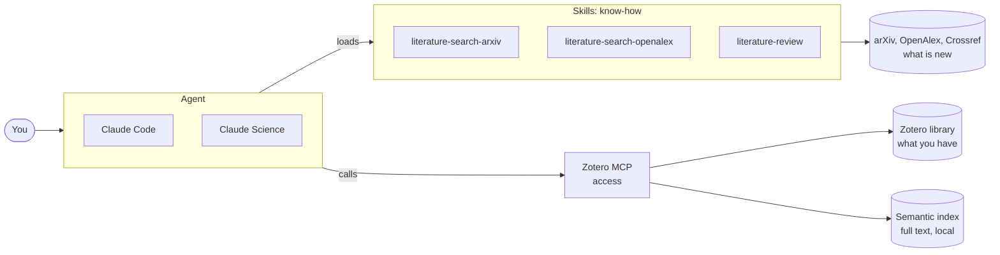
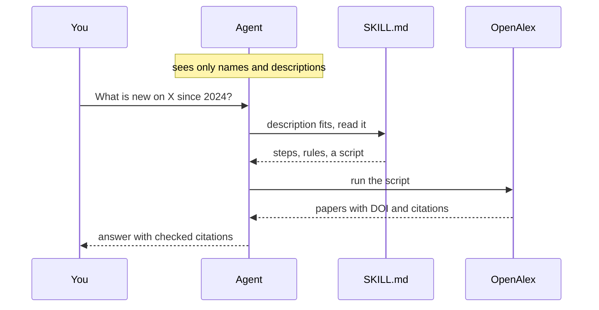
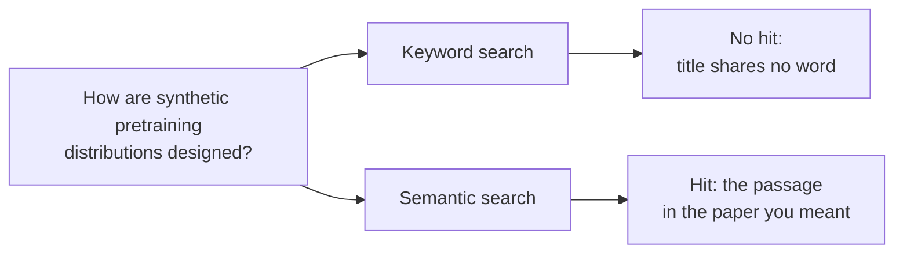
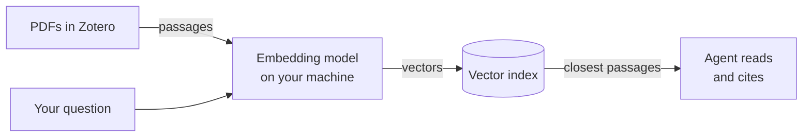
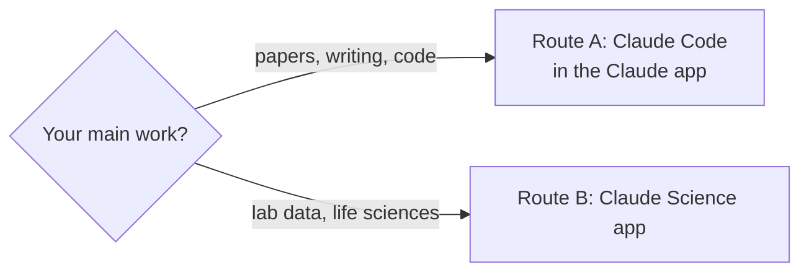
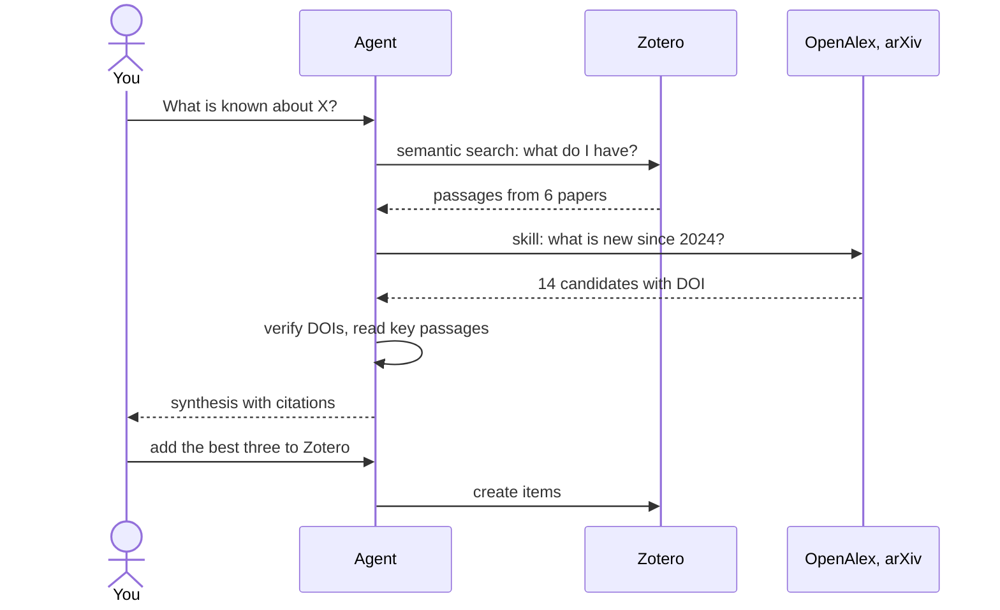

_Status: supported · Confidence: high · Last checked: 2026-10-30_

**TL;DR.** Three parts: an agent, skills that teach it literature search, and your Zotero library with a semantic index. Set up once in about 30 minutes, and Claude does most of it for you. Then you ask in plain language and get answers that cite papers you can open.



## Why bother

| Today                                           | With the setup                                  |
| ----------------------------------------------- | ----------------------------------------------- |
| Keyword search in Scholar, then again in Zotero | One question searches both                      |
| "I read this somewhere", title forgotten        | Found by what the paper claims                  |
| Chatbots invent references                      | Every citation is a retrieved record with a DOI |
| Paper in one window, its code in another        | One session reads both and compares them        |

## Three terms

**Agent.** Claude that acts: it runs searches, reads files and executes code, instead of only chatting.

**Skill.** A folder with a text file `SKILL.md`: a name, a one-line description, instructions, often scripts. Think of a shelf of lab protocols: the agent reads only the labels on the spines. When a task matches a label, it takes that protocol down and follows it. So a skill takes up no room in the agent's working memory until it is needed.

**MCP.** The [Model Context Protocol](https://modelcontextprotocol.io), a plug that connects the agent to a program, here Zotero.

A skill says _how_ to do something. MCP gives _access_ to something.



The head of a real skill from Google DeepMind, abridged:

```markdown
---
name: literature-search-arxiv
description: Search for scientific papers, preprints, and publications on arXiv.
  Use when the user asks to find research papers, literature, or specific arXiv IDs.
---

# arXiv Search and Retrieval

Maximum 1 request every 3 seconds. Always use the provided scripts.
```

## Why embed the library

Keyword search needs the words. You remember the claim. An embedding model turns every passage of every PDF into a vector that encodes its meaning. Your question becomes a vector too, and the nearest passages win.



- **Meaning over wording.** The query above found the paper I had in mind. Its title shares no word with the query.
- **Passages, not titles.** The index covers full texts in chunks, so a match lands on a page.
- **Local.** The index is built and stored on your machine, with a free embedding model that runs there too. Only passages the agent opens go to Claude.
- **Yours first.** The library holds what you already judged worth keeping. The literature skills fill the gaps.



## Pick a route



|                  | Claude Code                                    | Claude Science                                                |
| ---------------- | ---------------------------------------------- | ------------------------------------------------------------- |
| What             | Code tab of the Claude desktop app             | Research workbench app, in beta                               |
| Setup            | One prompt, Claude installs the rest           | A few clicks in Settings, plus four commands                  |
| Literature skill | arXiv and OpenAlex skills from Google DeepMind | Built-in literature review; a reviewer agent checks citations |
| Best for         | Any field, code, LaTeX, your own files         | Life sciences, analyses with figures and provenance           |
| Plan             | Claude Pro or higher                           | Pro, Max, Team or Enterprise; macOS and Linux                 |

## Step 1: Let Zotero talk

Both routes need this one click. Zotero 7 or newer: **Settings → Advanced**, tick _Allow other applications on this computer to communicate with Zotero_.

## Route A: Claude Code in the Claude app

No terminal needed. Claude Code runs the setup commands itself and asks before each one.

1. Install the [Claude desktop app](https://claude.com/download), sign in, open the **Code** tab and pick a folder to work in.
2. Paste this prompt:

   ```text
   Set me up for literature research with my Zotero library:
   1. Install zotero-mcp-server (github.com/54yyyu/zotero-mcp)
      with semantic search, use the free local embedding model
      and build the index over the full texts.
   2. Connect it to Claude Code as a user-level MCP server
      named zotero, with ZOTERO_LOCAL=true.
   3. Install the skills literature-search-arxiv,
      literature-search-openalex and uv from
      github.com/google-deepmind/science-skills for Claude Code.
   Explain each step in one sentence before you run it.
   ```

3. Start a new session and test the whole chain: _Search my Zotero library by meaning for a topic I know well._ It should return papers with matching passages. A broken embedding model shows no warning, only empty or failed searches. Type `/` to see the skills.

<details markdown="1">
<summary>Prefer to type it yourself? The same in a terminal</summary>

```bash
curl -fsSL https://claude.ai/install.sh | bash        # Claude Code
curl -LsSf https://astral.sh/uv/install.sh | sh       # uv
uv tool install "zotero-mcp-server[semantic]"
zotero-mcp setup --semantic-config-only               # 1 = free local model
zotero-mcp update-db --fulltext                       # build the index
claude mcp add zotero --scope user -e ZOTERO_LOCAL=true -- zotero-mcp
npx skills add google-deepmind/science-skills -g -a claude-code \
  -s literature-search-arxiv literature-search-openalex uv
```

For better search, still local: install [Ollama](https://ollama.com), run `ollama pull qwen3-embedding:0.6b` and pick option 4 in `zotero-mcp setup`. Ollama then has to run whenever you search. If it does not, the search fails with "connection refused" on `localhost:11434`.

</details>

## Route B: Claude Science

1. Download [Claude Science](https://claude.com/science) and sign in. On first start it asks which connectors and skills to turn on. Keep **Literature review**.
2. Install zotero-mcp and build the index. Either let Claude Code do it (prompt step 1 above), or in a terminal:

   ```bash
   curl -LsSf https://astral.sh/uv/install.sh | sh
   uv tool install "zotero-mcp-server[semantic]"
   zotero-mcp setup --semantic-config-only
   zotero-mcp update-db --fulltext
   ```

3. Connect Zotero: **Settings → Connectors → Add connector → Local command**. Name `zotero`, command `/Users/<you>/.local/bin/zotero-mcp`. Under _Advanced settings_ add the environment variable `ZOTERO_LOCAL=true`.
4. Optional, for arXiv: **Settings → Skills → Add skill → Import from GitHub**, then `google-deepmind/science-skills`.
5. In a chat, type `/` and pick `literature-review`, or just ask. Claude loads the skill when the task fits.

The first index build takes a while for a large library. Later updates only add what changed.

## Ask



Prompts that work:

- _Search my Zotero library first: what do I have on X? Then search OpenAlex for work since 2024 that I am missing. Cite with DOI._
- _Which paper in my library argues that Y? Quote the passage and give the page._
- _Compare what paper Z claims with what its GitHub code does._
- _Add the three most cited of these to my Zotero collection "Review 2026"._ Writing needs a one-time `zotero-mcp authorize-local`.

## Limits

- Scanned PDFs without OCR return nothing.
- The ranking is useful, the similarity score is not.
- Full texts are expensive in context. Search to locate, read selectively.
- The agent retrieves, you judge. Open every citation you keep.
- Long Claude Science runs use up plan limits quickly.

Open: whether indexing what I already collected quietly narrows what I look for next.

---

**Sources.** [Claude Code docs](https://code.claude.com/docs) · [Claude Science: connectors and skills](https://claude.com/docs/claude-science/connectors-and-skills) · [Google DeepMind science-skills](https://github.com/google-deepmind/science-skills) · [zotero-mcp](https://github.com/54yyyu/zotero-mcp) · [Model Context Protocol](https://modelcontextprotocol.io) · Diagrams drawn with [Pele](https://pele.run)
