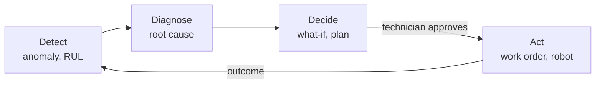
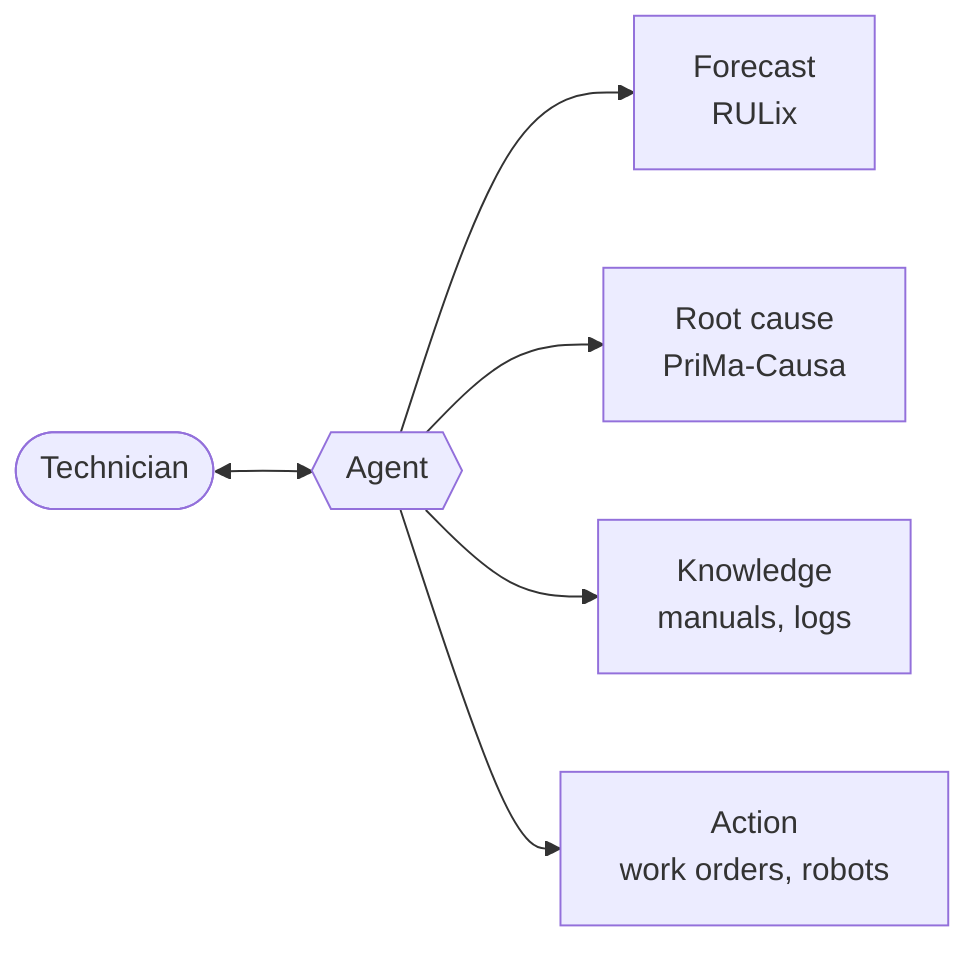

_Status: work in progress. This post is not finished yet and will still change._

**TL;DR.** Predictive maintenance answers _when_ a machine will fail. The technician still has to work out _why_ and _what to do_. Agentic maintenance closes that gap: a language-model agent calls specialised tools for forecasting, root cause analysis and documentation, proposes an action and acts only after a technician approves it. The language model orchestrates. The numbers come from algorithms that can be checked.

## From prediction to action

Maintenance research describes a ladder with four rungs: descriptive (what happened), diagnostic (why it happened), predictive (what will happen) and prescriptive (what to do about it).

| Level        | Question                    |
| ------------ | --------------------------- |
| Descriptive  | What happened?              |
| Diagnostic   | Why did it happen?          |
| Predictive   | What will happen, and when? |
| Prescriptive | How should it happen?       |

In the PriMa model by [Ansari et al. (2019)](https://doi.org/10.1080/0951192X.2019.1571236){:target="\_blank"}, the top rung ideally leads to machines that diagnose themselves and schedule their own maintenance. Their field test was still rule-based and already cut downtime by 12 to 25% on selected machine parts.

Most plants stand somewhere between diagnostic and predictive. A forecast that crosses its threshold still arrives as an alarm, and the knowledge to act on it sits in manuals, logs and the heads of a few technicians. An agent can walk the whole loop instead:

## The agent is the glue, not the brain

A language model should not estimate a remaining useful life or guess a root cause from its training data. It should call tools that compute these, read the results and explain them to the technician. Each tool below is a piece of my own work:





- **Forecast.** [RULix](/projects/15_remaining_useful_life/) predicts the remaining useful life zero-shot, without run-to-failure data from the target machine.
- **Root cause and decision.** [PriMa-Causa](/projects/1_prima_causa/) ranks maintenance actions by their causal effect on line performance. [Network-based root cause analysis](/projects/2_root_cause_networks/) shows which station and which signal drive the losses.
- **Knowledge.** An [offline assistant](/projects/17_maintenance_language_models/) answers questions from machine documentation on site, so no data leaves the plant.
- **Action.** In the [LeRobot workstation](/projects/13_lerobot_workstation/), robot skills are exposed through the Model Context Protocol (MCP). An agent calls a pick-and-place or an inspection like any other tool.

## What the research shows so far

**Tools beat retrieval.** [PHMForge (Li et al., 2026)](https://arxiv.org/abs/2604.01532){:target="\_blank"} tests agents on 99 expert-written prognostics scenarios with 39 MCP tools that wrap published algorithms. The best setup, Claude Code with Opus 4.6, solves 80.8% of them. Without the domain tools it solves 25%. When the tool calls are replaced by text retrieval (RAG), remaining-useful-life prediction on battery cells drops from 5 of 5 to 1 of 5 scenarios solved in all three runs.

**Planning is the weak spot.** Most failures are correct tool calls in the wrong order, in 23% of all trajectories. In the authors' words: "Frontier LLMs are stronger at calling tools than at planning when to call them."

**Agents overrate their own results.** If the agent does not have to compute its own error metrics, apparent success rises from 81.0% to 99.7%, but 31% of those successes are false. [Theiler et al. (2026)](https://arxiv.org/abs/2605.28371){:target="\_blank"} see the same in research code: their agent got 14 of 16 prognostics papers running, and they warn that code that runs is not yet a faithful reproduction.

**Grounding helps.** [CausalTrace (Shyalika et al., 2025)](https://arxiv.org/abs/2510.12033){:target="\_blank"} combines an agent with causal discovery and a process ontology. Its root cause ranking matched the expert-defined causes with a MAP@3 of 94%, against 44% for a correlation baseline, and the ontology keeps it from proposing impossible causal paths. So far it has been tested on replayed data from an academic assembly line.

**The idea is older than the models.** [KoMMDia (Rahm et al., 2018)](https://doi.org/10.1109/ETFA.2018.8502615){:target="\_blank"} already designed a dialogue assistant for fault diagnosis that leaves the decision to the operator. It also named the risks that still apply: skill decay, complacency and automation bias.

## Four rules for maintenance agents

1. **Tools compute, the model orchestrates.** Every number comes from a validated model behind a tool, never from the language model itself.
2. **Verify before claiming success.** The agent checks its results against thresholds or ground truth and says so when no tool fits the question.
3. **Decide on causes, not correlations.** For the same machine you never observe what more or less maintenance would have done, so a forecast alone cannot pick the action. [Vanderschueren et al. (2022)](https://arxiv.org/abs/2206.01562){:target="\_blank"} show that a causal policy cuts the decision error of a purely predictive one by about 45% on semi-synthetic maintenance data. PriMa-Causa answers these "what if" questions in one forward pass.
4. **The technician approves, the agent logs.** Every action waits for a human decision, every step is traceable, and machine data stay on site.

## Where this goes next

The building blocks exist: forecasts without run-to-failure data, causal rankings of maintenance actions, offline assistants and robots that speak MCP. What is missing is the loop around them and an honest way to test it. A [production-line simulator](/projects/10_production_line_simulator/) with known causal ground truth lets us inject faults and check whether an agent finds the cause and proposes the right action before it ever touches a real machine. Agentic maintenance is less about a smarter chatbot and more about wiring proven models into a loop with a technician at the decision point.

## References

- F. Ansari, R. Glawar, T. Nemeth: [PriMa: a prescriptive maintenance model for cyber-physical production systems](https://doi.org/10.1080/0951192X.2019.1571236){:target="\_blank"}, International Journal of Computer Integrated Manufacturing 32(4-5), 2019.
- Y. Li, T. Feng et al.: [PHMForge: Evaluating LLM Agents on Industrial Prognostics through MCP-Native, Algorithm-Grounded Tools](https://arxiv.org/abs/2604.01532){:target="\_blank"}, preprint, 2026.
- C. Shyalika et al.: [CausalTrace: A Neurosymbolic Causal Analysis Agent for Smart Manufacturing](https://arxiv.org/abs/2510.12033){:target="\_blank"}, preprint, 2025.
- R. Theiler et al.: [From paper to benchmark: agentic, framework-based reproduction of under-specified methods in machine health intelligence](https://arxiv.org/abs/2605.28371){:target="\_blank"}, preprint, 2026.
- J. Rahm et al.: [KoMMDia: Dialogue-Driven Assistance System for Fault Diagnosis and Correction in Cyber-Physical Production Systems](https://doi.org/10.1109/ETFA.2018.8502615){:target="\_blank"}, IEEE ETFA 2018.
- T. Vanderschueren et al.: [Prescriptive maintenance with causal machine learning](https://arxiv.org/abs/2206.01562){:target="\_blank"}, preprint, 2022.

## My work

- F. Saretzky et al.: [Integrating a Causal Foundation Model into a Prescriptive Maintenance Framework for Optimising Production-Line OEE](https://doi.org/10.1016/j.procir.2026.03.207){:target="\_blank"}, Procedia CIRP 2026.
- M. Orošnjak, F. Saretzky, S. Kędziora: [Prescriptive Maintenance: A Systematic Literature Review and Exploratory Meta-Synthesis](https://doi.org/10.3390/app15158507){:target="\_blank"}, Applied Sciences 2025.
